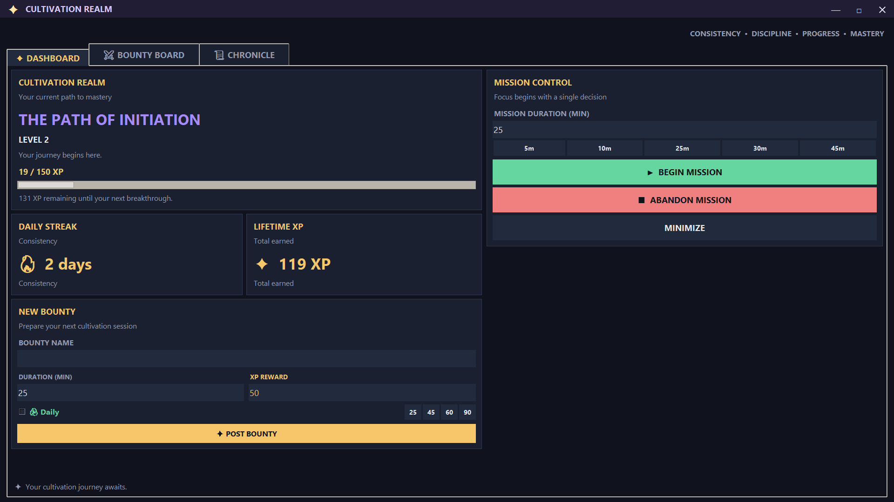
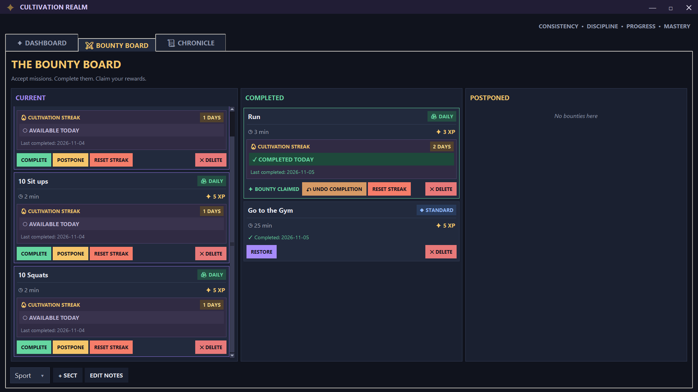
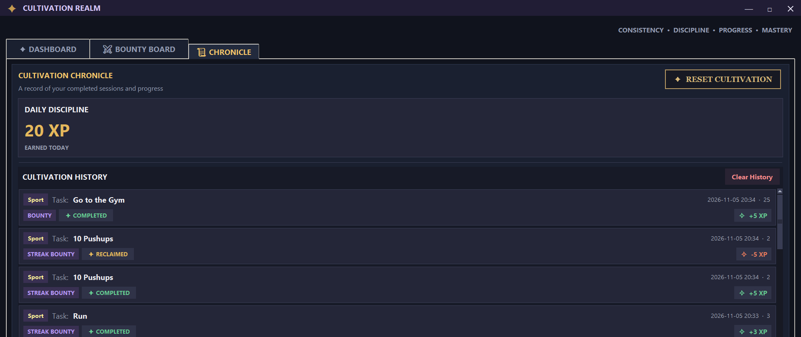
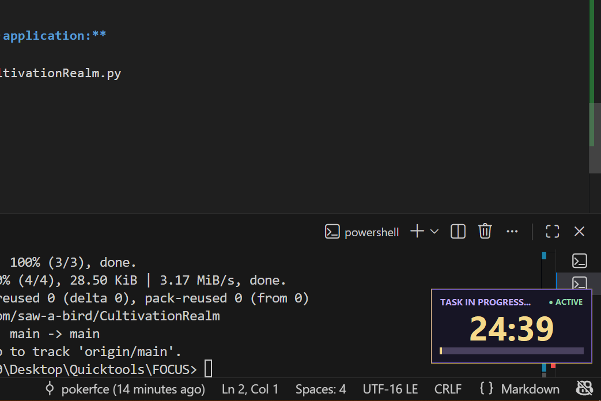
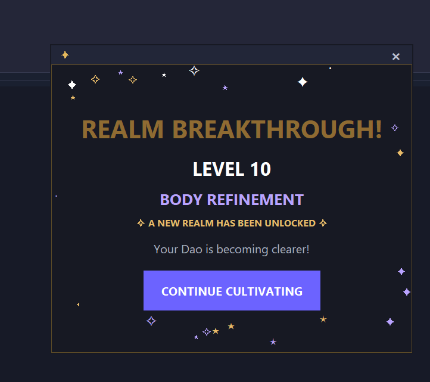

# Cultivation Realm

Turn your daily tasks into an epic journey of power and discipline. Cultivation Realm is a focus timer app inspired by fantasy cultivation stories, making productivity fun and rewarding.

## Screenshots

Explore the different features of Cultivation Realm:
| Screenshot | Feature |
|---|---|
|  | Dashboard – View your cultivation progress, XP, and current realm. |
|  | Bounty Board – Create, manage, and organize your tasks. |
|  | Chronicle – Review your completed sessions, bounties, and achievements. |
|  | Focus Timer – Showcase the immersive cultivation session timer. |
|  | Breakthrough – Celebrate ascending into a higher cultivation realm. |

and much more.

## Core Features

- **Ascend Through the Realms:** Start as a mere Mortal and gain XP to break through 16 distinct realms, from Body Refinement and Golden Core to True Immortal and Dao Ancestor.
- **The Bounty Board:** Create and manage tasks as bounties. Assign durations and XP rewards, and organize them into different Sects (projects).
- **Daily & Standard Bounties:** Post one-off tasks or recurring daily bounties. Build streaks through consistency.
- **Immersive Focus Timer:** Begin cultivation sessions to concentrate on your work. A floating, non-intrusive overlay tracks your time without interrupting your workflow.
- **The Chronicle:** Review your journey through a detailed history of completed sessions, claimed bounties, and XP earned.
- **Daily Discipline Streak:** Earn bonus XP by starting a session each day and maintaining your discipline.
- **Persistent Progress:** Your XP, realm, level, streaks, and bounties are saved locally in `cultivation_data.json`.
- **Optional Cultivation Reset:** Start a fresh journey whenever you wish by resetting your cultivation progress.

## The Path to Mastery

The core gameplay loop is simple:

1. **Post Bounties:** Define your goals on the Bounty Board.
2. **Begin Cultivation:** Start the focus timer and work toward your goals.
3. **Claim Rewards:** Complete focus sessions and mark bounties as finished to earn XP.
4. **Gain Power:** Accumulate XP, level up, and achieve breakthroughs into higher realms.
5. **Forge Discipline:** Maintain daily streaks to build powerful habits and earn consistency bonuses.

## Getting Started

### Prerequisites

- Python 3.x

### Installation

1. **Clone the repository:**

   ```sh
   git clone https://github.com/saw-a-bird/CultivationRealm.git
   ```

2. **Navigate to the project directory:**

   ```sh
   cd CultivationRealm
   ```

3. **Install the required packages:**

   ```sh
   pip install pystray Pillow
   ```

4. **Run the application:**

   ```sh
   python CultivationRealm.py
   ```

## Project Structure

```text
CultivationRealm/
├── CultivationRealm.py
├── README.md
├── cultivation_data.json  # Generated when the application runs
└── screenshots/
    ├── C1.png
    ├── C2.png
    ├── C3.png
    ├── C4.png
    ├── C5.png
```

## Built With

- Python 3
- Tkinter
- Pillow
- Pystray

---

*Your journey to immortality begins with a single step. Start cultivating.*
